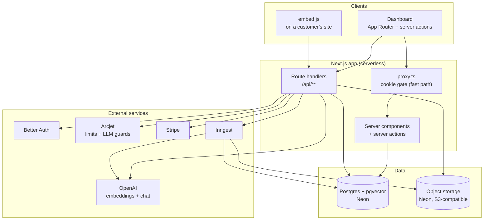
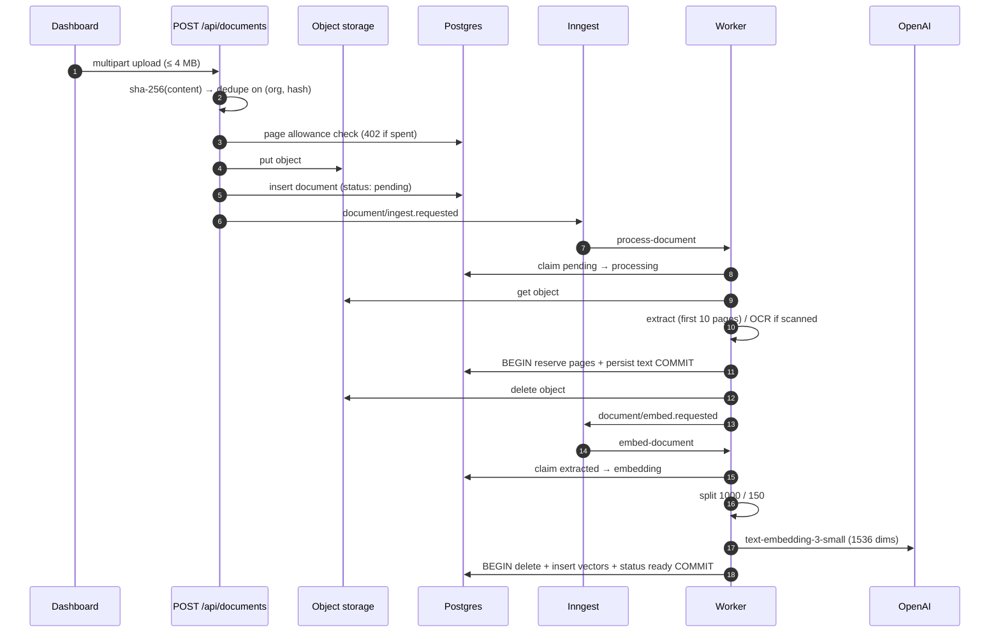
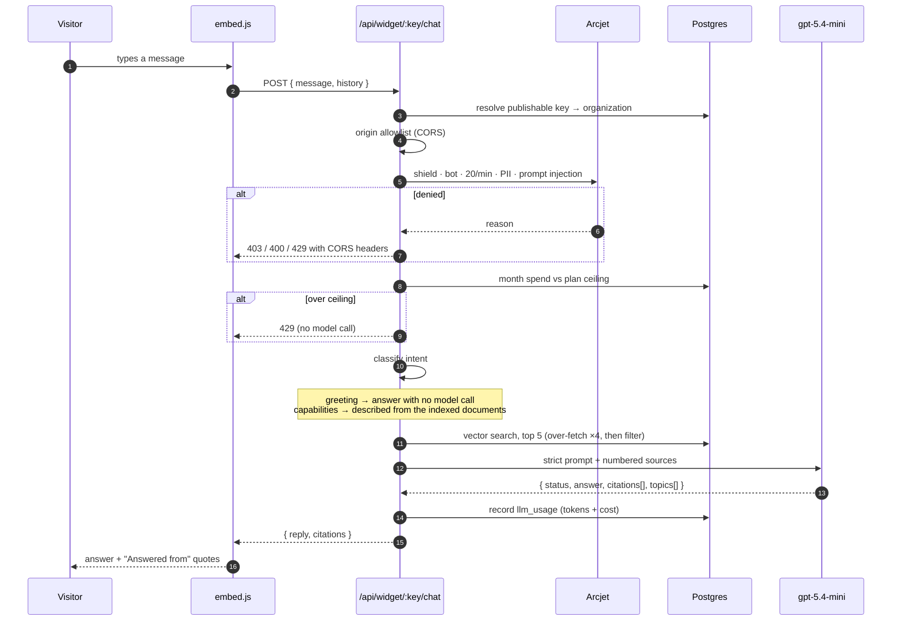
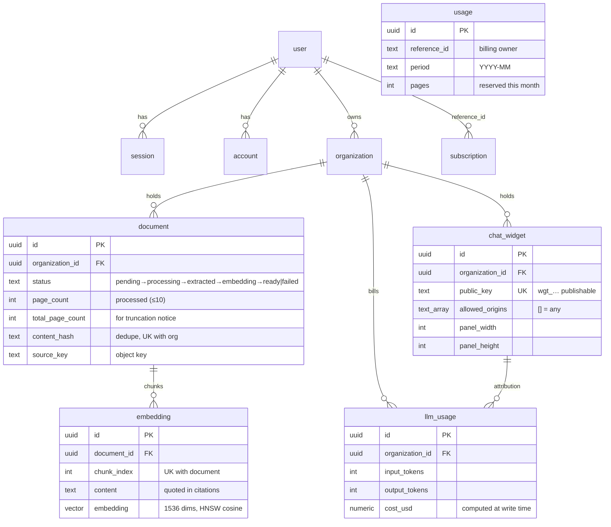

# AgentDesk

Turn your documents into an embeddable support assistant.

Upload PDFs and images, AgentDesk extracts the text (with OCR when needed), embeds it into
pgvector, and serves a chat widget you can drop on any site with one `<script>` tag.
Answers are grounded in retrieved passages and always come back with the source and a
verbatim quote — or an explicit "I don't know".

TypeScript · Next.js 16 (App Router, serverless) · React 19 · Postgres 17 + pgvector ·
Drizzle · Better Auth · Stripe · Inngest · OpenAI · Arcjet · Neon Object Storage

---

## Architecture



Two rules keep this honest:

- **Ownership is enforced in the database query, not in a prior read.** Every authenticated
  handler re-checks the real session (`requireApiSession`) and every query folds
  `owner_id` into its `WHERE`, so another tenant's row is indistinguishable from a
  missing one. `proxy.ts` is a fast pre-check, never the only gate.
- **The widget key is publishable by design** (`wgt_…`, it ships in the customer's HTML).
  It authorises exactly one widget → one organization, and the per-organization spend
  ceiling — not the IP limiter — is what bounds cost.

---

## Document pipeline

Two Inngest functions, so slow OCR never shares a retry budget with embedding.



Why it is shaped that way:

| Guard | Mechanism |
| --- | --- |
| Duplicate upload | `unique(organization_id, content_hash)`; a lost race adopts the winner's row |
| Duplicate job | `pending → processing` claim (0 rows updated = already claimed) |
| Double-charged pages | quota reservation and the text write commit in **one transaction** |
| Stuck rows | a retry is a single atomic `UPDATE … RETURNING`; runs older than 30 min are assumed dead |
| Partial failure | text is persisted before embedding, so re-indexing never re-extracts |
| Transient vs permanent | only a genuinely missing object is terminal; throttle/network errors retry |

---

## Widget request path



The answer contract is enforced by an OpenAI **strict JSON schema**, so the model cannot
invent fields. The prompt fixes three exact sentences — `I don't know.`,
`I don't know this part.` — and `reconcileStatus` re-derives `status` from the text it
actually produced, because the model labelled a partial answer "answered" when left to
itself.

---

## Data model



`subscription` references a plan by `key` (no FK) because the catalog is editable in the
database and reconciled from Stripe.

---

## Getting started

### 1. Install

```bash
pnpm install
cp .env.example .env    # then fill it in
```

### 2. Provision Postgres

Neon is the target (pgvector and HNSW included). You need **two** connection strings:

| Variable | Use |
| --- | --- |
| `DATABASE_URL` | pooled endpoint — application traffic |
| `DIRECT_DATABASE_URL` | direct endpoint — migrations only (DDL through a pooler is a known failure mode) |

### 3. Migrate

```bash
pnpm db:migrate        # applies drizzle/, including CREATE EXTENSION vector + the HNSW index
```

`drizzle-kit push` is dev-only and **cannot bootstrap an empty database** — it emits the
`vector(1536)` column without the extension and fails with `type "vector" does not exist`.
Migrations are the only provisioning path.

### 4. Seed the catalogs

```bash
psql "$DIRECT_DATABASE_URL" -f scripts/seed-plans.sql
psql "$DIRECT_DATABASE_URL" -f scripts/seed-model-prices.sql
```

Plans are idempotent upserts. Model prices drive the cost column in usage reporting; the
seeded `gpt-5.4-mini` rate ($0.75 in / $4.50 out per 1M) is a third-party figure — check it
against your plan and correct the row if needed. Cost is stored per call, so a correction
only affects future usage.

### 5. Object storage

Declare the bucket in `neon.ts` and run `neon deploy`; it provisions the bucket and writes
the `AWS_*` credentials. Then set `S3_BUCKET`, `S3_ENDPOINT`, `S3_REGION`.

Two Neon specifics are baked into the code: **path-style addressing is required**
(`forcePathStyle: true`), and ACL/policy writes return `501` — the bucket's access level is
set in Neon, not by this app. Without `S3_BUCKET`, uploads fall back to local disk in
development only; production refuses at call time.

Colocate the serverless function region with the database and bucket (Neon object storage
exists only in `aws-us-east-1/2`, `aws-eu-central-1`, `aws-ap-southeast-1`) or every upload
and read pays cross-region latency.

### 6. Background jobs

```bash
pnpm dev                                      # terminal 1
npx inngest-cli dev -u http://localhost:3000/api/inngest   # terminal 2
```

Without the Inngest server, uploads report **503** ("Could not queue processing") and no
document ever leaves `pending`.

### 7. Run

```bash
pnpm dev        # http://localhost:3000
```

---

## Scripts

| Command | What it does |
| --- | --- |
| `pnpm dev` / `build` / `start` | Next dev / production build / production server |
| `pnpm lint` | `biome check` — clean. `public/` is excluded: the embed loader is hand-written ES5 served verbatim, validated with `node --check` |
| `pnpm format` | Biome write |
| `pnpm typecheck` | `tsc --noEmit` |
| `pnpm test` | Node's built-in runner — **no test files exist yet** |
| `pnpm db:generate` / `db:migrate` / `db:studio` | Drizzle schema → SQL, apply, browse |
| `pnpm db:push` | Dev-only shortcut; not a provisioning path |

---

## Limits and quotas

| Limit | Value | Why |
| --- | --- | --- |
| Pages processed per document | **10** (`MAX_PAGES_PER_DOCUMENT`) | bounds OCR/CPU per job; longer documents are **truncated**, not rejected, and the UI shows "10 of 25" |
| Upload size | **4 MB** | the file is proxied through a serverless function; Vercel caps bodies at ~4.5 MB |
| Free tier (no subscription) | 1 organization · 25 pages/mo · no OCR · **$1** model spend | the product must work before payment |
| Starter / Pro / Scale | 1 / 3 / ∞ orgs · 100 / 500 / 1000 pages · OCR on Pro+ | see `scripts/seed-plans.sql` |
| Model spend ceiling | $2 / $8 / $20 per month | enforced before every model call; over the ceiling returns 429 and makes no request |
| Widget rate limit | 20 messages/min per widget+IP | Arcjet, with an in-process limiter as an unconditional backstop |
| Stalled-job window | 30 min | a `pending`/`processing`/`embedding` row older than this becomes retryable |

`MAX_PAGES_PER_DOCUMENT` is a real ceiling: on Vercel's hobby tier (60 s) a 10-page OCR run
is unrealistic, so use Pro or lower the constant.

---

## Security model

- **Sessions**: Better Auth on Postgres, 7-day expiry with daily rolling update. `proxy.ts`
  bounces signed-out users off `/dashboard` and answers `/api/**` with JSON 401; every
  handler then re-validates the session itself.
- **Rate limiting**: better-auth for auth endpoints, Arcjet for the widget. Arcjet fails
  **open** by design, which is why the in-process limiter runs regardless — a misconfigured
  Arcjet must not mean "no limits".
- **LLM guards**: Arcjet screens prompt injection and card numbers before retrieval; the
  prompt additionally treats documents and user text as data, never instructions.
- **Headers**: CSP (no nonce yet, so inline scripts are allowed; `frame-ancestors`,
  `object-src` and `base-uri` are the real protection), HSTS, `nosniff`,
  `Referrer-Policy`, `Permissions-Policy`, `X-Frame-Options: DENY`, no `X-Powered-By`.
- **Boot validation**: `src/instrumentation.ts` validates the env contract and warns loudly
  when a feature is degraded (no Stripe = no plan limits, no Arcjet = in-process limiter
  only, no bucket, email verification off).

---

## Known limitations

Deliberate, documented, and not silently ignored:

- **No automated tests and no CI.** (`pnpm test` is wired to Node's built-in runner, but there are no test files.) The pure logic (origins, intent, status reconciliation,
  quota maths, page thresholds, schemas) is the obvious first target.
- **Email verification is off** — accounts are usable with an unverified address. Needs a
  sender (Resend) before it can be enabled.
- **Uploads over 4 MB are rejected.** Raising it needs presigned direct-to-bucket uploads,
  which means the server no longer sees the bytes — and the dedupe hash is currently
  server-trusted.
- **Failed uploads are retained.** Neon accepts lifecycle rules but does not enforce them,
  so there is no expiry. Bounded by the 4 MB cap; revisit with a sweeper if storage grows.
- **The document detail page does not poll** (the list does), and the inline editor does not
  restore focus when it closes.
- **The in-process rate limiter is per instance.** The spend ceiling is the real boundary;
  a shared counter needs Redis.
- **Single-step OCR.** A platform timeout costs time, not money (retries are safe), but the
  job cannot resume mid-document.
- **HNSW recall degrades with many tenants.** Retrieval over-fetches 4× before filtering;
  per-tenant indexes would be the next step.
- **No error sink.** Diagnostics are structured `console.*`; the error boundaries carry a
  TODO rather than a Sentry integration.

---

## Troubleshooting

| Symptom | Cause |
| --- | --- |
| Upload returns 503 | Inngest server not running / `INNGEST_EVENT_KEY` missing |
| `type "vector" does not exist` | database built with `db:push` instead of `db:migrate` |
| Widget endpoints 500 after a schema change | the dev server is holding stale modules — restart it |
| Document stuck on "processing" | the worker died; wait for the 30-minute window, then Retry |
| Answers say "I don't know" for content you uploaded | check `status = ready` and that `embedding` rows exist for the document |
| `S3_BUCKET is not set` in production | object storage is required; see step 5 |
